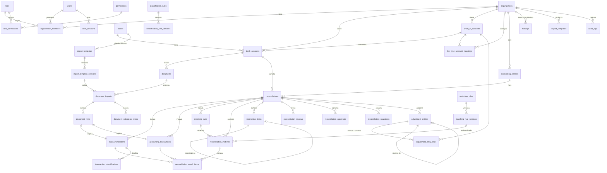

# FASE 0 — Auditoría y planificación · FinAgent AI v1

Fecha: 13/11/2026 · Estado: **PROPUESTA — pendiente de aprobación**

---

## 1. Auditoría del repositorio y del entorno

| Elemento                   | Resultado                                                                                                           |
| -------------------------- | ------------------------------------------------------------------------------------------------------------------- |
| Carpeta del proyecto       | `Conciliacion de bancos/` — **vacía** (solo este documento)                                                         |
| Git                        | **No inicializado**. Se propone `git init` con rama `main` al iniciar la Fase 1                                     |
| Node.js                    | v24.19.0 (vía nvm) ✔                                                                                                |
| npm                        | 11.17.0 ✔                                                                                                           |
| pnpm / yarn                | No instalados → se usarán **npm workspaces** (evita una herramienta extra)                                          |
| Docker / Compose           | 29.7.2 / v5.5.1, daemon activo ✔                                                                                    |
| PostgreSQL / Redis locales | No instalados → irán en contenedores (no hace falta instalarlos)                                                    |
| Python                     | 3.9.6 (no se usa)                                                                                                   |
| Máquina                    | macOS 26.6, Apple Silicon, 10 núcleos, 16 GB RAM → entorno de referencia para la meta de 50.000 movimientos < 2 min |

Conclusión: proyecto nuevo, sin código previo que preservar. No hay riesgo de sobrescribir trabajo existente.

---

## 2. Decisiones de arquitectura propuestas

| #   | Decisión                                                                                                                                                                                                                                                 | Motivo                                                                                                                                                                                                                                                   |
| --- | -------------------------------------------------------------------------------------------------------------------------------------------------------------------------------------------------------------------------------------------------------- | -------------------------------------------------------------------------------------------------------------------------------------------------------------------------------------------------------------------------------------------------------- |
| A1  | **Monorepo con npm workspaces**                                                                                                                                                                                                                          | Un solo repositorio, tipos compartidos entre frontend y backend, sin herramientas adicionales.                                                                                                                                                           |
| A2  | **El dominio financiero en un paquete TypeScript puro** (`packages/domain`), sin NestJS, sin Prisma                                                                                                                                                      | El motor, el cálculo de saldos ajustados y los días hábiles se prueban de forma aislada, rápida y determinista (cobertura ≥ 80 % exigida). Es también el punto donde se conecta `SuggestionProvider`.                                                    |
| A3  | **Parsers en paquete propio** (`packages/parsers`)                                                                                                                                                                                                       | Cada formato se prueba con archivos de ejemplo sin levantar la API.                                                                                                                                                                                      |
| A4  | **API y worker comparten código** (`apps/api`), con dos procesos: `main.ts` (HTTP) y `worker.ts` (BullMQ)                                                                                                                                                | Mismos módulos, repositorios y auditoría; se escalan por separado en Docker.                                                                                                                                                                             |
| A5  | **Dinero dentro del motor como enteros en centavos (`bigint`)**; `decimal.js` en los bordes (parseo, API, informes); `NUMERIC(18,2)` en BD; en JSON el dinero viaja **como string** (`"1234567.89"`)                                                     | Exactitud absoluta y velocidad (comparar `bigint` es mucho más rápido que `Decimal` en 50.000 × N comparaciones). El frontend nunca convierte importes a `Number`.                                                                                       |
| A6  | **Fechas contables como `DATE`** (sin hora)                                                                                                                                                                                                              | Evita el clásico error de “un día menos” por zona horaria. Las marcas de tiempo (`created_at`) en `timestamptz`, mostradas en America/Bogota.                                                                                                            |
| A7  | **Unicidad de conciliación garantizada por la base de datos**: índice único parcial sobre `reconciliation_match_items` donde la coincidencia está _confirmada_                                                                                           | Resuelve la prueba 17 (concurrencia) sin depender del código: el segundo usuario recibe `409 Conflict`. Las sugerencias sí pueden superponerse (necesario para marcar “ambigua”). Prisma no soporta índices parciales: se crean con SQL en la migración. |
| A8  | **Multiorganización a nivel de aplicación**: toda tabla de negocio lleva `organization_id`; los repositorios exigen el contexto de organización (también en workers)                                                                                     | Más simple y depurable que RLS de PostgreSQL con Prisma. Se cubre con la prueba 24. RLS queda como refuerzo opcional para la Fase 10.                                                                                                                    |
| A9  | **Auditoría inmutable**: tabla solo-inserción; el usuario de BD de la aplicación no tiene `UPDATE`/`DELETE` sobre `audit_logs` + trigger que lo impide                                                                                                   | La inmutabilidad no depende de que el código “se porte bien”.                                                                                                                                                                                            |
| A10 | **Número de cuenta cifrado** con AES-256-GCM a nivel de aplicación + columna `account_last4` para mostrar `****3456` + huella HMAC para la unicidad                                                                                                      | Permite la restricción única (org + banco + número) sin guardar el número en claro. Clave en variable de entorno (en producción, gestor de secretos).                                                                                                    |
| A11 | **Sesiones**: access token JWT de 15 min + refresh token rotativo, ambos en cookies `httpOnly; Secure; SameSite=Strict`; refresh guardado con hash en `user_sessions` (detección de reutilización); protección CSRF con doble envío de token             | Cumple el contrato `/api/auth/refresh` y permite cerrar sesiones remotamente.                                                                                                                                                                            |
| A12 | **Periodo vs. conciliación**: `accounting_periods` = mes por organización (año, mes); `reconciliations` = cuenta + periodo (única) y **su estado es el estado del periodo de esa cuenta** (Abierto → En conciliación → En revisión → Aprobado → Cerrado) | Evita tener dos máquinas de estado que se desincronicen. La reapertura incrementa `revision`; los snapshots aprobados anteriores se conservan.                                                                                                           |
| A13 | **PDF de informes con pdfmake** (no Chromium sin interfaz)                                                                                                                                                                                               | Ligero, tablas, marca de agua “PRELIMINAR” y bloque de firmas sin un navegador en el servidor.                                                                                                                                                           |

---

## 3. Estructura de carpetas propuesta

```text
/ (raíz del monorepo)
├── apps/
│   ├── web/                      # React + Vite + Tailwind + shadcn/ui
│   │   └── src/
│   │       ├── app/              # router, rutas centralizadas (routes.ts), providers
│   │       ├── layouts/          # AppLayout, Sidebar, Header
│   │       ├── components/       # globales: DataTable, MoneyCell, StatusBadge, FileDropzone, ColumnMapper…
│   │       ├── features/         # dashboard, reconciliation-center, documents, admin, reports…
│   │       ├── api/              # cliente HTTP + hooks TanStack Query
│   │       ├── theme/            # tokens semánticos claro/oscuro
│   │       └── lib/              # formato COP, fechas DD/MM/AAAA
│   └── api/                      # NestJS
│       ├── prisma/               # schema.prisma, migraciones, seed
│       └── src/
│           ├── main.ts           # proceso HTTP
│           ├── worker.ts         # proceso de colas (importación, motor, informes)
│           ├── common/           # guards RBAC, contexto de organización, idempotencia, errores
│           ├── infrastructure/   # prisma, redis/bullmq, storage S3, cifrado, correo
│           └── modules/          # auth, organizations, users, bank-accounts, chart-of-accounts,
│                                 # periods, holidays, import-templates, documents, transactions,
│                                 # reconciliation, rules, adjustments, approvals, audit, reports,
│                                 # notifications
├── packages/
│   ├── domain/                   # TS puro: money, business-days, adjusted-balance,
│   │                             # matching-engine (reglas 1–6), classification, adjustment-builder,
│   │                             # SuggestionProvider (interfaz)
│   ├── parsers/                  # csv, xlsx/xls, ofx, camt053, pdf-text + normalización
│   └── contracts/                # esquemas Zod compartidos (DTO de la API)
├── infra/
│   ├── docker/                   # Dockerfiles
│   └── postgres/                 # init: roles y permisos de BD (auditoría solo-inserción)
├── fixtures/                     # archivos 100 % ficticios del seed (CSV/XLSX/OFX/XML/PDF)
├── e2e/                          # Playwright
├── docs/
├── docker-compose.yml
├── .env.example
└── package.json                  # workspaces
```

---

## 4. Modelo de datos

### 4.1 Convenciones

- PK `id UUID` (v7, ordenable por tiempo). `created_at`, `updated_at` (`timestamptz`), `created_by`.
- Toda tabla de negocio: `organization_id` + FK + índice.
- Dinero `NUMERIC(18,2)`; tasas `NUMERIC(18,4)`. Ningún `FLOAT`/`DOUBLE`.
- Soft delete (`deleted_at`) solo en configuración (plantillas, reglas, usuarios). **Nunca** en movimientos, documentos, auditoría ni snapshots.
- Bloqueo optimista con columna `version INT` en `reconciliations`, `reconciliation_matches` y `adjustment_entries`.

### 4.2 Diagrama entidad-relación (núcleo)



### 4.3 Tablas clave (campos principales)

**bank_accounts**: `bank_id`, `name`, `account_number_enc` (bytea), `account_number_hmac` (único con org + banco), `account_last4`, `type` (CORRIENTE/AHORROS), `currency_code`, `gl_account_id` (PUC), `opening_balance NUMERIC(18,2)`, `opening_balance_date DATE`, `opened_at`, `status`.

**reconciliations**: `bank_account_id`, `period_id` — **UNIQUE(bank_account_id, period_id)** —, `status`, `revision`, `currency_code`, `bank_opening_balance`, `bank_closing_balance`, `book_opening_balance`, `book_closing_balance`, `prepared_by`, `submitted_at`, `reviewed_by`, `approved_by`, `closed_at`, `version`.

**bank_transactions / accounting_transactions** (separadas, mismo núcleo):
`reconciliation_id`, `bank_account_id`, `document_row_id` (origen: archivo + fila + datos originales en JSONB), `external_id`, `operation_date DATE`, `value_date DATE`, `description_original`, `description_normalized`, `reference`, `document_number`, `amount NUMERIC(18,2)` (con signo: + entra, − sale), `currency_code`, `movement_type`, `running_balance`, `fingerprint` (SHA-256), `duplicate_status` (NONE / POSSIBLE / CONFIRMED_DUPLICATE / DISMISSED), `match_status` (derivado, para filtros rápidos).
Solo auxiliar: `third_party_name`, `third_party_nit`, `voucher_type`, `voucher_number`.
Índices: `(bank_account_id, operation_date)`, `(bank_account_id, amount)`, `(reconciliation_id, match_status)`, `fingerprint`.

**reconciliation_matches**: `reconciliation_id`, `matching_run_id` (nulo si es manual), `rule_version_id`, `kind` (EXACT / DATE_WINDOW / GROUP / APPROXIMATE / MANUAL / CARRY_FORWARD), `status` (SUGGESTED / AMBIGUOUS / CONFIRMED / REJECTED / UNDONE), `score 0–100`, `criteria JSONB` (criterios cumplidos, explicación reproducible), `amount_difference`, `days_difference`, `justification`, `created_by` (usuario o `SYSTEM`), `confirmed_by`, `confirmed_at`, `undone_by`, `undo_reason`, `version`.

**reconciliation_match_items**: `match_id`, `side` (BANK/BOOK), `bank_transaction_id` o `accounting_transaction_id` (CHECK: exactamente uno), `is_active` (verdadero solo cuando la coincidencia está CONFIRMED).
→ `CREATE UNIQUE INDEX ... ON reconciliation_match_items(bank_transaction_id) WHERE is_active;` (y lo mismo para `accounting_transaction_id`).

**reconciling_items**: `reconciliation_id`, `type` (CHEQUE_NO_COBRADO / CONSIGNACION_EN_TRANSITO / NOTA_DEBITO_NO_REGISTRADA / NOTA_CREDITO_NO_REGISTRADA / ERROR_BANCO / ERROR_LIBROS), `subtype` (GMF, COMISION, IVA, INTERES, RETEFUENTE…), `amount` (con signo según su efecto en su lado), `original_date`, transacción de origen (FK a un lado), `carried_from_item_id`, `origin_reconciliation_id`, `follow_up_status` (EN_GESTION / POR_IDENTIFICAR / RESUELTA), `responsible_id`, `comment`.

**adjustment_entries / lines**: `status` (BORRADOR / APROBADO / EXPORTADO / REVERSADO), `entry_date`, `third_party` (banco), `reversal_of_id`, `source_reconciling_item_ids`; líneas con `gl_account_id`, `debit`, `credit`, `cost_center`. CHECK de BD: cada línea tiene débito **o** crédito; regla de dominio + validación al aprobar: Σ débitos = Σ créditos.

**audit_logs**: `organization_id`, `actor_id`, `action`, `entity`, `entity_id`, `before JSONB`, `after JSONB`, `reason`, `source` (UI/API/WORKER), `ip`, `correlation_id`, `created_at`. Solo inserción.

El resto de tablas (sección 16 del master prompt) siguen el mismo patrón. El esquema Prisma completo y `docs/DATABASE.md` se entregan en la Fase 1.

### 4.4 Cálculo de saldos ajustados (dominio)

```text
banco_ajustado  = saldo_extracto + Σ consignaciones_en_tránsito − Σ cheques_no_cobrados ± Σ errores_banco
libros_ajustado = saldo_libros   − Σ notas_débito + Σ notas_crédito ± Σ errores_libros
diferencia      = banco_ajustado − libros_ajustado        (verde solo si es exactamente 0)
```

Además: no se puede enviar a revisión mientras haya movimientos **sin clasificar** (ni conciliados, ni partida conciliatoria, ni duplicado resuelto). Así se evita que una diferencia de cero salga “por casualidad”.

---

## 5. Contratos de la API (convenciones)

Se adoptan los endpoints de la sección 22 del master prompt. Convenciones transversales:

| Tema                | Convención                                                                                                              |
| ------------------- | ----------------------------------------------------------------------------------------------------------------------- |
| Base                | `/api`, JSON, OpenAPI en `/api/docs` (solo en desarrollo o con autenticación)                                           |
| Organización        | Encabezado `X-Organization-Id`; el backend verifica que el usuario sea miembro                                          |
| Dinero              | Strings decimales con punto: `"amount": "-4000.00"` + `"currency": "COP"`                                               |
| Fechas              | `"2026-10-31"` (ISO) en la API; el formato DD/MM/AAAA es solo de presentación                                           |
| Paginación          | `?page=1&pageSize=100&sort=operationDate:desc`; respuesta `{ data, page, pageSize, total }`                             |
| Errores             | `{ "code": "RECONCILIATION_DIFFERENCE_NOT_ZERO", "message": "<en español>", "details": {...}, "correlationId": "..." }` |
| Idempotencia        | Encabezado `Idempotency-Key` obligatorio en importar, ejecutar motor, aprobar, cerrar, exportar                         |
| Concurrencia        | `If-Match: <version>` en acciones sobre conciliaciones/ajustes → `409` si cambió                                        |
| Trabajos asíncronos | Las acciones largas devuelven `202 { jobId }`; progreso en `GET /api/jobs/:id`                                          |

Ajustes propuestos al listado original:

- **Nuevo** `GET /api/jobs/:id` (progreso de importación, motor e informes).
- **Nuevo** `POST /api/reconciliations/:id/matches/bulk` (aceptar o rechazar en lote).
- **Nuevo** `GET /api/reconciliations/:id/transactions?side=bank|book` (los paneles de la mesa de trabajo, paginados por el servidor).
- `POST /api/documents/upload` solo guarda el archivo y calcula SHA-256; la vista previa (`/preview`) y la confirmación (`/import`) son pasos separados, como exige el flujo.

El detalle de cada DTO se genera con Zod (`packages/contracts`) y se publica en `docs/API.md` en cada fase.

---

## 6. Dependencias previstas y justificación

| Dependencia                                                                                                   | Para qué                                                                                             | Nota                                                                                                                            |
| ------------------------------------------------------------------------------------------------------------- | ---------------------------------------------------------------------------------------------------- | ------------------------------------------------------------------------------------------------------------------------------- |
| NestJS, Prisma, PostgreSQL 16, Redis, BullMQ                                                                  | Lo exige el stack                                                                                    | —                                                                                                                               |
| decimal.js                                                                                                    | Dinero en los bordes                                                                                 | —                                                                                                                               |
| zod                                                                                                           | Validación compartida frontend/backend                                                               | Una sola definición de DTO                                                                                                      |
| argon2                                                                                                        | Contraseñas                                                                                          | —                                                                                                                               |
| papaparse + iconv-lite                                                                                        | CSV/TXT, detección de separador y **codificación Windows-1252** (muy común en extractos colombianos) | —                                                                                                                               |
| SheetJS (xlsx)                                                                                                | XLSX **y XLS antiguo**                                                                               | Se instala desde el CDN oficial de SheetJS: la versión de npm (0.18.5) tiene vulnerabilidades conocidas. exceljs no lee `.xls`. |
| fast-xml-parser                                                                                               | CAMT.053 y OFX v2 (XML)                                                                              | OFX v1 (SGML) con un parser propio pequeño                                                                                      |
| pdfjs-dist                                                                                                    | Extraer texto de PDF digital                                                                         | —                                                                                                                               |
| pdfmake                                                                                                       | Informes PDF                                                                                         | —                                                                                                                               |
| @aws-sdk/client-s3                                                                                            | MinIO/S3                                                                                             | —                                                                                                                               |
| file-type                                                                                                     | Verificar la firma real del archivo (no confiar en la extensión)                                     | —                                                                                                                               |
| Frontend: React, Vite, Tailwind, shadcn/ui, TanStack Query/Table/Virtual, RHF, Recharts, Lucide, React Router | Los exige el stack                                                                                   | —                                                                                                                               |
| Mailpit (contenedor, solo dev)                                                                                | Probar correos de invitación y recuperación                                                          | —                                                                                                                               |

**No se instala ningún SDK de IA.**

---

## 7. Riesgos identificados

| #   | Riesgo                                                                                                                                                                                                                                           | Impacto                                             | Mitigación                                                                                                                                                                                                                                                              |
| --- | ------------------------------------------------------------------------------------------------------------------------------------------------------------------------------------------------------------------------------------------------ | --------------------------------------------------- | ----------------------------------------------------------------------------------------------------------------------------------------------------------------------------------------------------------------------------------------------------------------------- |
| R1  | **GMF y comisiones idénticas el mismo día** (mismo importe, fecha y descripción) son legítimas y frecuentes. Si la huella no incluye la fila, se marcarían como duplicadas por error; si la incluye, nunca se detectan duplicados entre archivos | Alto (falsos duplicados o duplicados no detectados) | Dos huellas: **contenido** (sin fila) para detectar cargas solapadas entre archivos, y **contenido + posición** para trazabilidad. Dentro de un mismo archivo, las líneas idénticas se marcan “posible duplicado” con baja severidad y con agrupación (ver pregunta P9) |
| R2  | Cuentas en **USD**: el auxiliar del ERP suele estar en COP con una columna en moneda extranjera                                                                                                                                                  | Alto (no se podría conciliar en USD)                | La plantilla del auxiliar debe mapear la columna USD; si no existe, la cuenta USD no se concilia hasta resolverlo (pregunta P5)                                                                                                                                         |
| R3  | **PDF**: cada banco tiene un diseño distinto; extraer columnas de PDF es frágil                                                                                                                                                                  | Medio                                               | El PDF va al final de la Fase 5; plantilla por banco basada en patrones de línea; si la extracción no cuadra con el saldo, se rechaza. Recomendación: pedir al banco el extracto en Excel/CSV siempre que sea posible                                                   |
| R4  | Rendimiento con 50.000 movimientos (Prisma `createMany`, uso de `Decimal`)                                                                                                                                                                       | Medio                                               | Inserción por lotes (o `COPY`), motor en memoria con `bigint` e índices hash por importe; prueba de rendimiento en la Fase 6                                                                                                                                            |
| R5  | Explosión combinatoria en la regla 3 (suma de subconjuntos)                                                                                                                                                                                      | Medio                                               | Límite de tamaño de grupo (por defecto 6), ventana de fechas, poda por importe y tope de combinaciones por movimiento; si se excede, se reporta “no evaluado”, nunca se cuelga                                                                                          |
| R6  | Formatos numéricos ambiguos (`1.234,56` vs `1,234.56`) y fechas (`03/04` = 3 de abril o 4 de marzo)                                                                                                                                              | Alto                                                | La plantilla define los separadores y el formato de fecha de forma explícita; la vista previa valida que los saldos cuadren antes de confirmar                                                                                                                          |
| R7  | Archivos maliciosos (macros, fórmulas, XML con entidades externas)                                                                                                                                                                               | Alto                                                | Se leen solo valores en caché, sin evaluar fórmulas; XML sin DTD ni entidades externas; firma de archivo verificada; límite de tamaño; el parser corre en el worker                                                                                                     |
| R8  | Gestión de la clave de cifrado                                                                                                                                                                                                                   | Alto                                                | Clave por variable de entorno en desarrollo; gestor de secretos en producción; versión de la clave guardada junto al dato cifrado para poder rotarla                                                                                                                    |
| R9  | Alcance muy grande (10 fases)                                                                                                                                                                                                                    | Alto                                                | Hitos de prueba contigo tras las Fases 5, 7 y 9 con tus archivos reales (anonimizados)                                                                                                                                                                                  |
| R10 | Ley 1581 (datos de terceros en el auxiliar: nombres y NIT)                                                                                                                                                                                       | Medio                                               | Cifrado en reposo del almacenamiento, acceso por rol, retención configurable, ningún dato real en el repositorio                                                                                                                                                        |

---

## 8. Plan de implementación

| Fase               | Entregable                          | Resultado verificable                                                                                                              |
| ------------------ | ----------------------------------- | ---------------------------------------------------------------------------------------------------------------------------------- |
| 1 Fundación        | `PHASE-1-FOUNDATION.md`             | `docker compose up` levanta web, api, worker, Postgres, Redis, MinIO y Mailpit; migración inicial; lint y tests corren en CI local |
| 2 Design system    | `PHASE-2-DESIGN-SYSTEM.md`          | Temas claro/oscuro con tokens, sidebar, header, componentes base, dashboard vacío                                                  |
| 3 Auth y admin     | `PHASE-3-AUTH.md`                   | Login, invitaciones, roles, sesiones, rutas protegidas, auditoría inicial; pruebas 18 y 24                                         |
| 4 Datos maestros   | `PHASE-4-MASTER-DATA.md`            | Cuentas (cifradas), PUC importable, mapeo de notas, periodos, festivos de Colombia                                                 |
| 5 Documentos       | `PHASE-5-DOCUMENTS.md`              | CSV/XLSX → OFX → CAMT.053 → PDF; mapeador visual; validación de saldos; duplicados; pruebas 5, 12, 13. **Hito 1 contigo**          |
| 6 Motor            | `PHASE-6-RECONCILIATION-ENGINE.md`  | Reglas 1–6, versionado, `matching_runs`; pruebas 1–4, 6–11, 14, 16, 17; prueba de rendimiento                                      |
| 7 Mesa de trabajo  | `PHASE-7-WORKBENCH.md`              | Doble panel virtualizado, conciliación N:N, deshacer, partidas, panel de saldos en tiempo real; prueba 15. **Hito 2 contigo**      |
| 8 Ajustes y cierre | `PHASE-8-APPROVAL-CLOSING.md`       | Asientos cuadrados y exportables, flujo elaborador/revisor/aprobador, snapshot, cierre, arrastre; pruebas 19–23                    |
| 9 Informes         | `PHASE-9-REPORTS.md`                | Informe oficial PDF/XLSX/CSV con firmas y marca “PRELIMINAR”, antigüedad, GMF, dashboard real. **Hito 3 contigo**                  |
| 10 QA              | `PHASE-10-QA.md`, `FINAL-REPORT.md` | E2E Playwright, seguridad, accesibilidad, rendimiento, documentación de despliegue                                                 |

El seed ficticio (sección 27) se construye de forma incremental: archivos en la Fase 5 y escenarios que cuadran a $0 en las Fases 6 y 7.

---

## 9. Preguntas de negocio pendientes

| #   | Pregunta                                                                                                                                                                                     | Por qué importa                                                                 | Valor por defecto si no se responde                                       |
| --- | -------------------------------------------------------------------------------------------------------------------------------------------------------------------------------------------- | ------------------------------------------------------------------------------- | ------------------------------------------------------------------------- |
| P1  | ¿Qué **software contable** usan (Siigo, World Office, Alegra, Helisa, SAP…)? ¿Pueden compartir un auxiliar de bancos de ejemplo **anonimizado** y el formato de importación de comprobantes? | Define la plantilla del auxiliar y la exportación de ajustes                    | Plantilla genérica configurable                                           |
| P2  | ¿Qué **bancos** son prioritarios? ¿Pueden compartir un extracto anonimizado de cada uno (idealmente Excel/CSV)?                                                                              | Las plantillas se crean a partir de archivos reales; no se inventan estructuras | Solo plantillas del seed ficticio                                         |
| P3  | ¿Confirman las **cuentas PUC** del mapeo (GMF 511595 vs 530595, comisiones 530515, intereses 421005, retención 135515)?                                                                      | Afecta a los asientos de ajuste                                                 | Las sugeridas, editables                                                  |
| P4  | ¿El **IVA sobre comisiones** va como mayor valor del gasto o como IVA descontable (2408)?                                                                                                    | Cambia el asiento                                                               | Configurable; por defecto, mayor valor del gasto                          |
| P5  | Cuentas en **USD**: ¿el auxiliar trae el valor en USD además de COP? ¿Necesitan diferencia en cambio?                                                                                        | Sin el valor en USD no se puede conciliar (riesgo R2)                           | Conciliación solo en USD; diferencia en cambio fuera de alcance v1        |
| P6  | **Tolerancias**: ¿±3 días hábiles para la regla 2? ¿Redondeo de ±$1.000 o ±0,1 %? ¿Tamaño máximo de grupo en la regla 3?                                                                     | Parámetros del motor                                                            | 3 días, ±$1.000 (el menor de los dos), grupo de máximo 6                  |
| P7  | **Separación de funciones**: ¿quien elabora nunca puede aprobar? ¿Basta con dos personas (revisor = aprobador)?                                                                              | Flujo de aprobación                                                             | Activa; revisor y aprobador pueden ser la misma persona, el elaborador no |
| P8  | ¿Qué reglas pueden **autoconciliar** sin intervención?                                                                                                                                       | Supervisión humana vs. velocidad                                                | Solo la regla 1 (exacta)                                                  |
| P9  | GMF: ¿se **agrupa en una sola partida/asiento mensual**? ¿Las líneas idénticas el mismo día se tratan como normales (no duplicadas)?                                                         | Volumen de partidas (riesgo R1)                                                 | Sí agrupar; las líneas idénticas en un mismo archivo no bloquean          |
| P10 | ¿Será **una sola empresa** o varias (contador que atiende varios clientes / SaaS)?                                                                                                           | Alcance del multiorganización y la facturación                                  | Multiorganización desde el diseño, sin facturación                        |
| P11 | ¿Dónde se va a **desplegar** (nube como AWS/Azure/GCP, servidor propio, solo local)?                                                                                                         | Almacenamiento, cifrado, correo, copias de seguridad                            | Docker Compose genérico; se decide en la Fase 10                          |
| P12 | **Volumen** esperado: número de cuentas, movimientos por mes y número de usuarios                                                                                                            | Dimensionamiento                                                                | Hasta 50.000 movimientos por conciliación                                 |
| P13 | ¿Retención de documentos de **5 años** o 10 (Código de Comercio, art. 60)?                                                                                                                   | Política de retención                                                           | 10 años por prudencia (configurable)                                      |
| P14 | ¿Hay **SMTP** disponible para correos (invitaciones, recuperación de contraseña, notificaciones)?                                                                                            | Funciones de correo                                                             | Mailpit en desarrollo; notificaciones solo dentro de la app               |
| P15 | ¿El informe oficial debe llevar **logo** y algún formato interno específico de la empresa?                                                                                                   | Diseño del PDF                                                                  | Formato estándar de saldos ajustados                                      |

---

## 10. Próximo paso

**DETENIDO a la espera de aprobación.** Para iniciar la Fase 1 necesito:

1. La aprobación (o cambios) de las decisiones A1–A13, la estructura de carpetas y el modelo de datos.
2. Las respuestas a las preguntas P1–P15 que se puedan responder ya (las demás se asumen con su valor por defecto y se pueden cambiar después).
3. Autorización para `git init` en esta carpeta.
